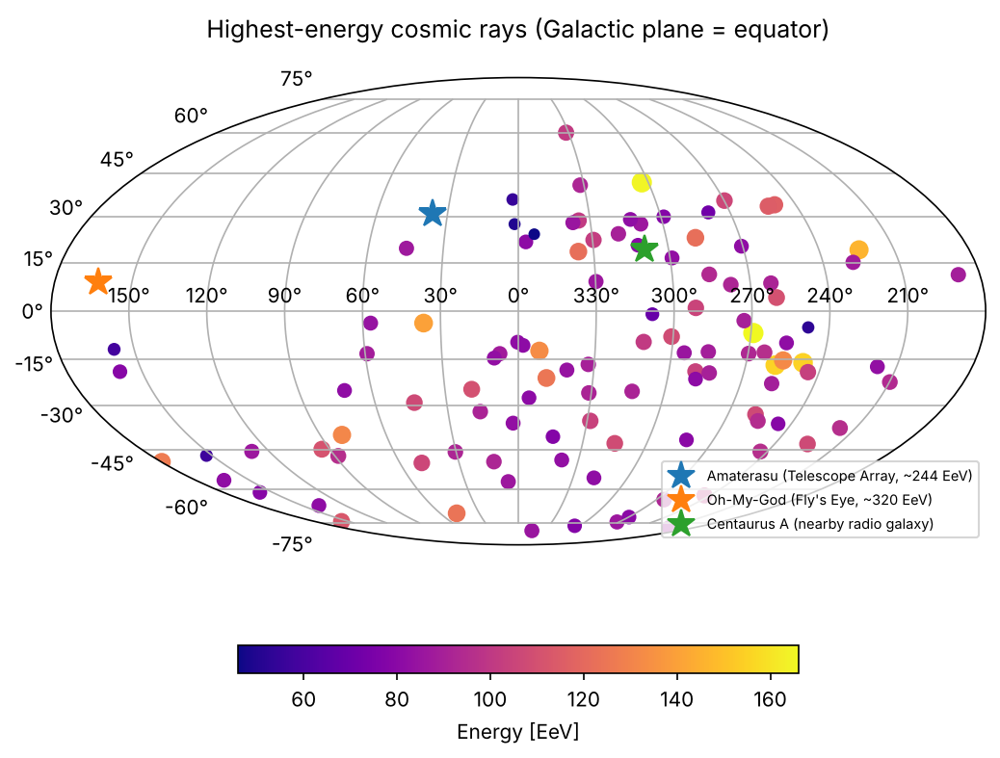
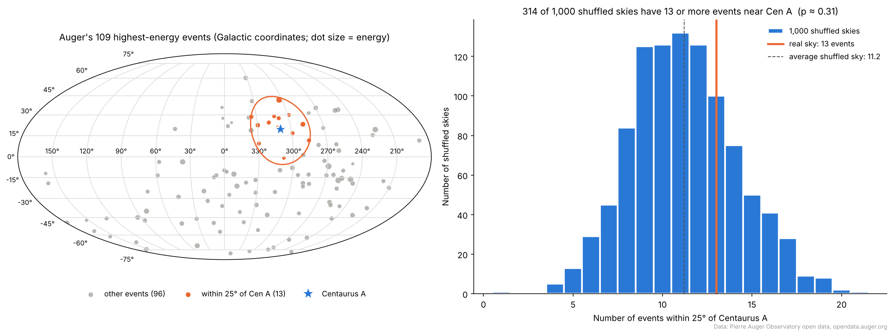
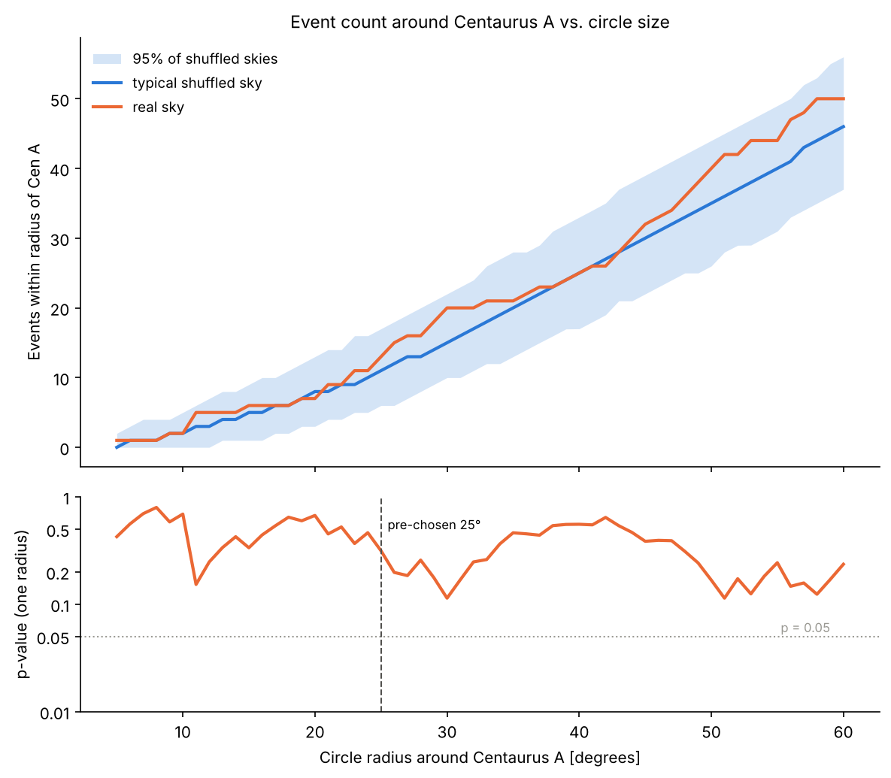
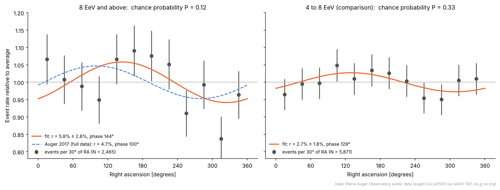
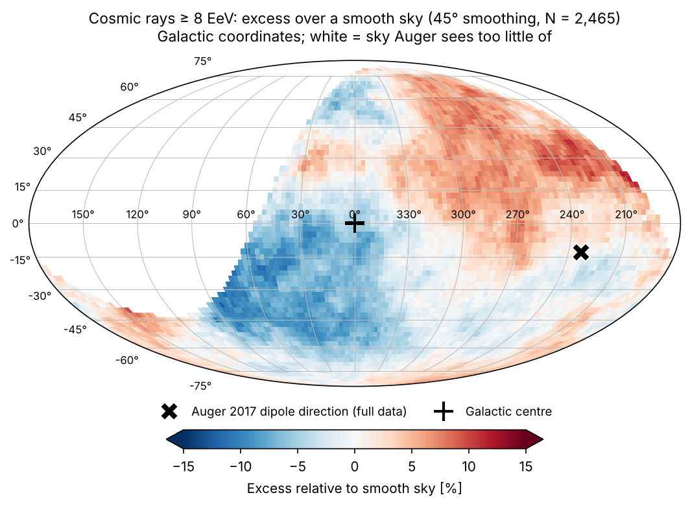

# Project 20: Where do the highest-energy particles come from?

**Question:** Do the most energetic particles ever recorded come from particular places in the sky, such as the nearby active galaxy Centaurus A?

**Short answer from public data:** There are hints, but nothing we can call significant yet. Around Centaurus A we see 13 events where chance would give about 11 (p ≈ 0.31). Above 8 EeV the sky looks lopsided in roughly the direction Auger reported in 2017: more particles from the side opposite our galaxy's centre. With only the public ~10% of Auger's data, though, that pattern would happen by chance about 12% of the time. The large-scale dipole is real in Auger's full dataset; we're seeing its outline, not proving it.

## How to run

From the repo root:

```bash
python3 starters/20_cosmic_ray_skymap.py   # first plot (saves to the current folder)
python3 project20/cena_significance.py     # Thursday prototype: Cen A vs 1,000 shuffled skies
python3 project20/dipole_8EeV.py           # stretch goal: large-scale dipole above 8 EeV
```

Each script downloads its data once into `data/` (under 2 MB total) and saves its figures to `plots/`.

## 1. First plot: sky map of the top events



Auger's 109 highest-energy events, 2004–2020 (46–166 EeV; 101 of them are above 78 EeV), in Galactic coordinates. Dot size and colour show energy. The empty upper-left region is the northern sky, which Auger (in Argentina) can barely see.

## 2. Thursday prototype: is there a pile-up around Centaurus A?



**Method**
1. Count events within **25°** of Centaurus A. We chose that radius *before* looking at the result; it's close to the 27° Auger uses.
2. Make **1,000 shuffled skies.** Each event keeps its declination (north–south position) but gets a random right ascension (east–west position). The Earth's rotation sweeps every right ascension past Auger equally, so this keeps Auger's real view of the sky while erasing any sources.
3. **p-value** = the fraction of shuffled skies with at least as many events near Cen A as the real sky.

**Result:** 13 events observed, 11.2 expected on average, and 314 of 1,000 shuffled skies did at least as well, so **p ≈ 0.31**. Not significant. Using only the 101 events above 78 EeV gives the same answer (12 observed against 10.5 expected, p ≈ 0.36).



**Exploring other radii:** The real sky sits a little above the shuffled skies at most radii, but it never leaves the 95% band. The smallest p is 0.11, at 30°. Trying many radii and keeping the best one makes a result look stronger than it is (the "look-elsewhere effect"), so the fair number is the pre-chosen 25° answer.

**Why Auger's own papers find more:** Auger reports about a 4σ excess around Cen A using tens of thousands of events above ~40 EeV. This catalog has only 109 events, too few to see a signal of that size.

## 3. Stretch goal: the large-scale dipole above 8 EeV

Data: Auger's public SD1500 event list. That's 2,465 events at 8 EeV or more, plus 5,871 events between 4 and 8 EeV used as a comparison.



**Method (Rayleigh analysis):** If cosmic rays came equally from everywhere, their right ascensions would be spread evenly. We fit `rate = average × (1 + r·cos(RA − phase))` and compute the chance probability `P = exp(−N r² / 4)`.

| Energy | Events | Amplitude r | Phase | Chance P |
|---|---|---|---|---|
| ≥ 8 EeV | 2,465 | 5.8% ± 2.8% | 144° | 0.12 |
| 4–8 EeV | 5,871 | 2.7% ± 1.8% | 129° | 0.33 |
| Auger 2017, ≥ 8 EeV (full data) | 32,187 | 4.7% | 100° | 2.6×10⁻⁸ (5.2σ) |

Our amplitude agrees with Auger's within the error bars, and the 4–8 EeV comparison is weaker, as Auger also found. The noise level (±2.8%) is as big as half the signal, though, so you'd need roughly 10 times more events to detect it on your own.



**Sky map:** For each spot on the sky we count events within 45° and compare with the shuffled-sky average. You can see a deficit (blue) around the Galactic centre and an excess (red) on the other side, roughly toward Auger's published dipole direction (✕). Neighbouring pixels share events, so this map is a picture, not a significance; the Rayleigh P above is the honest number.

## Limitations (good to mention in the demo)

- Auger corrects its full analysis for small effects we ignored: weather, the array growing during 2004–2008, and the geomagnetic field. These corrections are small compared with our ±2.8% statistical noise.
- The public SD1500 set covers zenith angles up to 60°. Auger's 2017 analysis went to 80°, which shows more of the northern sky.
- Shuffling right ascension can only test east–west structure. Measuring the north–south part of the dipole needs a proper exposure model.

## Data sources (please cite)

- Pierre Auger Collaboration, catalog of the highest-energy cosmic rays, 2004–2020, Pierre Auger Observatory open data: https://opendata.auger.org/catalog/ (paper: Abreu et al. 2023, ApJS 264, 50).
- Pierre Auger Observatory public data release, SD1500 events (`auger3.ev_sd1500`), served through GAVO's TAP service at https://dc.g-vo.org/tap. See also https://opendata.auger.org.
- Pierre Auger Collaboration 2017, "Observation of a large-scale anisotropy in the arrival directions of cosmic rays above 8 × 10¹⁸ eV", *Science* 357, 1266. This is the source of the 4.7% / 100° comparison numbers and the dipole direction (l, b) ≈ (233°, −13°).
